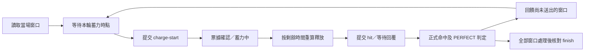

# 青元子 16 輪動態窗口：協定、歷史數據與 v16

本次核對 2026-09-12、09-13 六帳號共 **12 份戰鬥、192 個窗口**，並對照
9 月 13 日取得的官方 Mini App。相鄰兩擊相隔 **2.754–10.764 秒**；
每帳號、每場的時間表都不同。歷史中心時間不會拿來排下一場。

## 從入口到正式結算

1. 各帳號從新鮮入口取得自己的 WebView 認證及 session；需要驗證時走
   原有官方瀏覽器驗證。`/start` 等候本場 challenge，`actionLimit=1`
   是參戰資格，不是只能打一次。
2. `/begin` 成功後，以回覆的 `startsInMs`、本次網路 RTT 與 monotonic
   clock 建立本帳號的開戰基準。驗證等待時間不算網路 RTT。
3. `/window(afterWindowId)` 逐輪揭示 `id/centerMs/hitMs/perfectMs`。
   尚未揭示就等下一次讀取；去重同一 id。提早出現 `done` 不會漏掉
   宣告的窗口數。每輪獨立排程，前一擊慢回覆不阻塞讀取下一輪。
4. 預計釋放時間是 `中心 − RTT/2 − 已學到的漂移 + 帳號偏移`；預計
   按下時間再扣除蓄力目標。原基準 **1000 ms**，按已收到的服務端
   蓄力差修正，限制於 560–1210 ms。尚未送出的計畫可隨新回執更新。
5. 按下時送 `/charge-start`。只有正式回覆含有效票據才進入已確認
   蓄力；這時仍不算命中。回覆太慢時，以當下剩餘窗口重新核對蓄力
   下限、到達期限及票據年齡上限，使用能容納的補蓄力餘量。
6. 釋放時送 `/hit`，沿用該窗口票據。`holdMs` 是真實本地按下至
   釋放的時長；服務端蓄力則是「命中到達 − 票據簽發」，兩者不同。
   本場 PERFECT 時機容差為 ±210 ms、蓄力區間為 520–1250 ms，
   命中時機容差為 ±620 ms；執行時以當場窗口回覆為準。
7. 只有帳號／窗口匹配的正式命中才增加命中數，且 `hit.perfect=true`
   才增加 server PERFECT。到達偏差 `deltaMs` 是絕對值；若早、晚
   兩種解都符合請求區間，保留方向不確定，不憑猜測調整漂移。
8. 等待各輪在途結果及末窗期限，送 `/finish` 並核對正式結算。
   Boss 已敗、帳號死亡或同帳號手動衝突時走相應停止／核對流程。
   傳輸未確認只能在該動作仍有效時重試；過期窗口不重播。

## 今日主帳 16 輪

下表為 @demo_player_01 的正式歷史資料，中心相對本帳號開戰時間。
「揭示餘量」是讀到該窗口時距中心還剩多久，不是可保證的蓄力時間。
服務端偏差為絕對值，不能直接解讀成全部晚到。

| 輪 | 中心（秒） | 距上輪（秒） | 揭示餘量 ms | 本地蓄力 ms | 服務端蓄力 ms | 服務端偏差 ms | 正式結果 |
| --- | --- | --- | --- | --- | --- | --- | --- |
| 1 | 2.257 | — | 1148 | 983 | 971.5 | 11.3 | PERFECT |
| 2 | 9.274 | 7.017 | 1546 | 986 | 988.7 | 10.5 | PERFECT |
| 3 | 12.245 | 2.971 | 1492 | 1024 | 996.4 | 37.2 | PERFECT |
| 4 | 15.179 | 2.934 | 1384 | 1112 | 1082.6 | 129.0 | PERFECT |
| 5 | 24.802 | 9.623 | 1714 | 1007 | 988.9 | 21.2 | PERFECT |
| 6 | 29.569 | 4.767 | 1311 | 964 | 983.2 | 6.6 | PERFECT |
| 7 | 39.186 | 9.617 | 1226 | 1017 | 1027.0 | 15.4 | PERFECT |
| 8 | 42.717 | 3.531 | 1597 | 1015 | 1008.5 | 36.0 | PERFECT |
| 9 | 47.805 | 5.088 | 1662 | 1083 | 762.8 | 78.0 | PERFECT |
| 10 | 55.673 | 7.868 | 1487 | 1009 | 1019.3 | 19.3 | PERFECT |
| 11 | 58.900 | 3.227 | 1676 | 1002 | 1015.7 | 15.3 | PERFECT |
| 12 | 64.635 | 5.735 | 1585 | 958 | 955.9 | 29.6 | PERFECT |
| 13 | 74.330 | 9.695 | 1318 | 1002 | 998.2 | 25.5 | PERFECT |
| 14 | 77.190 | 2.860 | 1697 | 1002 | 1396.8 | 378.3 | 命中，非 PERFECT |
| 15 | 81.912 | 4.722 | 919 | 698 | 705.4 | 34.9 | PERFECT |
| 16 | 86.213 | 4.301 | 1186 | 967 | 973.2 | 36.3 | PERFECT |

其餘五帳號及昨日全部窗口可在本機
`state/reports/2026-09-13-qyz-windows/windows.html` 切換查看，原數字在
`window-timelines.json`。兩天分別為 83／96 次確認命中、69／90 次
server PERFECT。昨日主帳 11 窗為手動／自動衝突；另兩窗缺少可重建
的正式成功時序，均保留失敗證據。

## 以官方排行榜驗收

以 [本場官方貢獻榜](https://t.me/example_game_group/7310786/12303637) 作歷史基準。
前七名貢獻均為 3760 分、強攻均為 16 次，傷害介乎 7.23–7.71 億億；
其他玩家的逐擊及 PERFECT 數未公開。下表以第 7 名的 **7.23 億億** 作
較近的傷害參考，增幅以本方各帳號的正式傷害為分母。

| 帳號 | 公告名次 | 貢獻分 | 確認命中 | PERFECT | 傷害（億億） | 達參考傷害所需增幅 |
| --- | --- | --- | --- | --- | --- | --- |
| @demo_player_04 | 9 | 3719 | 16/16 | 16/16 | 6.9592 | +3.89% |
| @demo_player_01 | 10 | 3711 | 16/16 | 15/16 | 6.9107 | +4.62% |
| @demo_player_05 | 未列前十 | — | 16/16 | 15/16 | 6.8749 | +5.17% |
| @demo_player_03 | 未列前十 | — | 16/16 | 15/16 | 6.8161 | +6.07% |
| @demo_player_06 | 未列前十 | — | 16/16 | 14/16 | 6.7251 | +7.51% |
| @demo_player_02 | 未列前十 | — | 16/16 | 15/16 | 6.6859 | +8.14% |

主帳若達到本場榜首的 7.71 億億，所需傷害增幅約 **11.57%**；
@demo_player_03 約 **13.11%**。參考數字經公告四捨五入，百分比為近似值。
傷害追平不等於名次追平；3760 只是在本榜觀察到的最高貢獻分，
不是已知的理論上限。未列前十帳號的貢獻分和確切名次保持未知，
不以個人戰鬥的甲等 100 分代替。

本方最高帳號已 16/16 PERFECT，仍比第 7 名少 41 貢獻分；其第 5 輪
PERFECT 的服務端蓄力只有 562.1 ms。這支持繼續檢查有效蓄力，但缺少
其他玩家的戰力、逐擊及正式傷害公式，不能把全部差距歸因於時序。
v16 的較早揭示與回執喚醒旨在保留動態窗口內的可用蓄力時間，
維持 1000 ms 基準。下一場逐帳號比較 16/16 正式 PERFECT、蓄力分布、
finish 傷害與官方貢獻榜；未取得新回執前不宣稱提升。

互動報告的傷害參考可在第 7 名／榜首間切換，全部數據可由
`leaderboard-baseline.json` 的來源 SHA 追溯到官方公告和逐擊回執。

## 本次 v16 修補

- **窗口查詢按請求開始計時。** 官方頁面限制兩次請求開始至少相隔
  360 ms；v15 在尚未揭示新窗口的回覆後再等 360 ms，300 ms RTT 時
  變成約 660 ms。
  v16 去掉這段額外等待，每帳號同時仍只有一個窗口讀取，不補發突發
  查詢；一般錯誤保留原回覆後退避。
- **等待中的計畫會被新回執喚醒。** v15 只在舊計時器醒來後重讀漂移，
  新目標若更早就已錯過；蓄力中收到新回饋也未立即改動釋放計時器。
  v16 由已到達的蓄力／漂移回饋喚醒計畫，重算尚未送出的動作。
  已送出的 charge 不重送、不移動真實按下時間；釋放改動仍重查票據
  與窗口限制，取消等待時會收乾淨子任務。
- **每輪保留自己的即時狀態。** 等待蓄力、票據待回覆、蓄力中、
  已釋放待回覆、確認 PERFECT／普通命中、拒絕及未確認均分開。
  一般 `/window` 輪詢不會覆蓋這些狀態。每輪記錄計畫時間、實際
  charge／release／reply 時間、真實本地與服務端蓄力及正式偏差。
  明確拒絕不會被較晚的計畫觀察覆蓋。

即時資料由原帳號主控寫入
`qingyuanzi-new-source/state/accounts/<account>/world_boss_state.json` 的
`world_boss_events[].window_states`；正式結果也包含同一批窗口快照。
沒有新增排程、寫入者或 Telegram 通知。狀態轉換持久化；普通讀取輪詢
仍沿用 v15 的延後刷新，避免重寫整份歷史。

## 驗證與效果界線

- 先在隔離工作副本重現輪詢額外等待、待蓄力更新過晚、蓄力期間不重排
  釋放三項問題；修補後 **125 項 QYZ 測試、119 項相關健康測試通過**。
  新增測試包含不規則 16 輪、單一在途讀取、拒絕／缺失回執、事件隔離
  及取消等待清理。fixture 的判定使用自身到達時間和票據年齡。
- 179 個有足夠時序的歷史命中可分解為 328 種非負傳輸方向。選出九份
  完整 16 輪紀錄，做 **594 組整場回放**（兩個方向邊界及每場 64 組
  固定種子混合），每輪只使用當時已到達的回覆來更新後續控制。
  固定原揭示時間後，v16 與 v15 無新增失分，蓄力時長也一致。
  這沒有假裝知道歷史上更快輪詢會何時首次取得窗口。
- 另外用官方形狀的模擬伺服器、16 個不等間隔窗口及 300 ms RTT
  檢查查詢改善：

| 模擬服務端提前揭示 | 最短服務端蓄力 v15 → v16 | 平均服務端蓄力 v15 → v16 | PERFECT |
| --- | --- | --- | --- |
| 1250 ms | 540 → 640 ms | 706.2 → 740.6 ms | 兩者均 16/16 |
| 1400 ms | 620 → 760 ms | 838.7 → 938.7 ms | 兩者均 16/16 |
| 1600 ms | 730 → 1000 ms | 930 → 1000 ms | 兩者均 16/16 |

以上只證明這些模擬條件下能較早讀到窗口、保留更多蓄力時間，
**不是正式傷害或排名提升**。正式頁面的 demo 傷害公式未用來預測實戰。
歷史資料也不支持把基準直接增至 1050 ms，或宣稱更積極的漂移公式
穩定較好；本次保持 1000 ms 和既有漂移算法，只改其更新通知與排程。

三份參考附件的原始 SHA-256 可由更新後 `ADAPTATIONS.patch` 反向還原；
CF、原生瀏覽器驗證及 worker 的保留函式本文未變。測試沒有向遊戲或群組
發送測試指令。原場次部分結算不改綠。

部署與下一場的正式回執驗收另存本機 `checkpoint.json`。仍須確認六帳號
各自 16/16 server PERFECT、finish，以及新場的傷害／官方排行榜，
才能聲稱實戰成績改善。排行榜基準見
[今日官方排行榜復盤](qyz-battle-review-2026-09-13.md)。
